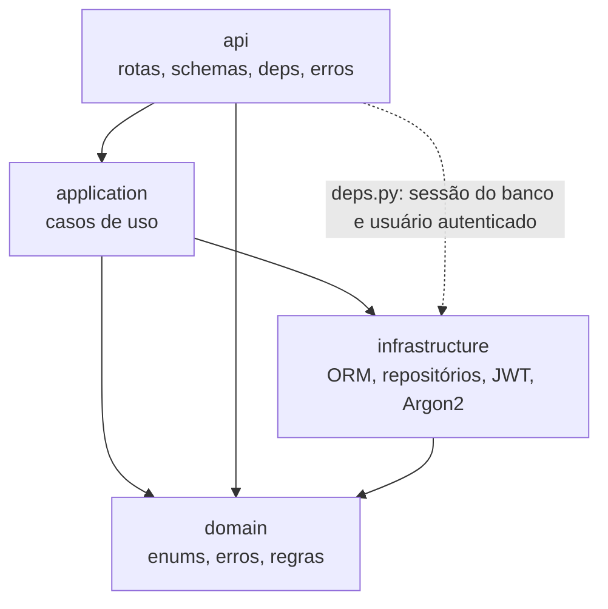

# Arquitetura em camadas

> Nota: elaborado com apoio de IA (Claude Code) e revisado pelo autor.

Este documento descreve como o código da API é dividido. Ele também serve de base para a seção de arquitetura do relatório.

## Por que separar

Até esta separação, toda a API ficava em `app/main.py`: rotas, regras de negócio, consultas ao banco, JWT e formato de erro. O roteiro pede separação em camadas, e o PLAN.md já previa os módulos `api`, `application`, `domain` e `infrastructure`. Com a separação:

- as regras de negócio ficam em um lugar só e não dependem de FastAPI nem de SQLAlchemy;
- as funcionalidades que ainda faltam (cadastro, estoque, cancelamento, falha 503, fidelidade) entram na camada certa desde o início;
- o relatório consegue explicar cada camada apontando para arquivos reais.

**Objetivo:** reorganizar o código sem mudar o comportamento da API, exceto o que está listado em "Mudanças visíveis". Os testes que já existiam continuam verificando o mesmo comportamento, com duas exceções: as importações mudam, e os testes do PATCH de status passam a enviar o status de destino.

**Fora do escopo:** novas funcionalidades, troca de banco e inversão completa de dependências (portas e adaptadores).

**Seria um fracasso se:** algum endpoint mudasse de rota, de formato de resposta ou de código de erro sem que isso estivesse listado na seção "Mudanças visíveis".

## Abordagens consideradas

| Abordagem | Como funciona | Prós | Contras |
| --- | --- | --- | --- |
| **Camadas diretas (escolhida)** | O domínio tem enums, erros e regras puras. A aplicação tem os casos de uso e chama repositórios concretos da infraestrutura. A API tem rotas, schemas e a conversão de erro para HTTP. | Pouco código a mais, fácil de explicar e de manter até a entrega. | A aplicação depende das classes concretas do banco. |
| Portas e adaptadores | O domínio tem entidades próprias (dataclasses). A aplicação define interfaces de repositório e a infraestrutura as implementa, convertendo ORM em entidade. | Inversão de dependência completa; regras testáveis sem banco. | Duplica modelos e mapeamentos, com cerca do dobro de código. |
| Divisão por funcionalidade | Pastas `pedidos/`, `auth/` etc., cada uma com rota, serviço e consulta. | Agrupa o que muda junto. | Não mostra as camadas que o roteiro e o PLAN.md pedem. |

A escolha foi das camadas diretas, feita pelo autor em 23/11/2026, a partir das alternativas apresentadas pelo assistente de IA (Claude Code).

## Estrutura

```text
app/
  main.py                cria o FastAPI, registra rotas e tratadores de erro
  domain/
    enums.py             Perfil, CanalPedido, StatusPedido, ResultadoPagamento,
                         CenarioPagamento, FinalidadeConsentimento, MotivoCancelamento,
                         TipoMovimentacao, TipoMovimentoFidelidade
    errors.py            ErroDominio e subclasses (NaoAutenticado, PermissaoNegada,
                         NaoEncontrado, Conflito, DadosInvalidos, ServicoIndisponivel)
    regras.py            canais por perfil, quem paga e quem cancela, transições
                         de status, quando cancelar, acesso ao pedido, prazo da reserva,
                         gerente da unidade, saldo após movimentação de estoque,
                         senha forte e versão dos termos de uso, pontos ganhos e
                         desconto do resgate de fidelidade
  application/
    auth.py              cadastro de cliente, login e identificação do usuário pelo token
    catalogo.py          unidades e cardápio (libera reservas vencidas antes)
    pedidos.py           expirar, criar, consultar, listar, pagar (mock), cancelar,
                         mudar status
    estoque.py           registrar e listar movimentações de estoque
    fidelidade.py        crédito, resgate, estorno e extrato de pontos
    consentimentos.py    listar e registrar consentimentos
    auditoria.py         consultar auditoria da unidade
  infrastructure/
    db.py                engine, sessão e Base (movido de app/db.py)
    models.py            tabelas ORM (movido de app/models.py)
    repositorios.py      classes de consulta: Usuario, Catalogo, Oferta, Pedido,
                         Pagamento, Movimentacao, Fidelidade, Consentimento e Auditoria
    seguranca.py         hash de senha (Argon2) e JWT
  api/
    deps.py              sessão do banco, esquema Bearer e usuário autenticado
    erros.py             formato único de erro e conversão ErroDominio -> HTTP
    schemas.py           modelos Pydantic de entrada e saída
    rotas/               auth, catalogo, pedidos, estoque, consentimentos, fidelidade,
                         auditoria
migrations/versions/     0001 (modelo inicial), 0002 (movimentacao_estoque) e
                         0003 (fidelidade_movimento e desconto no pedido),
                         conferidas contra os modelos por tests/test_migracoes.py
```



## Regras entre camadas

1. **domain** não importa nada de FastAPI, Pydantic ou SQLAlchemy. As regras recebem valores simples (perfil, status, canal) e lançam `ErroDominio`.
2. **application** orquestra cada caso de uso: chama as regras do domínio, usa os repositórios, grava a auditoria e confirma a transação (`commit`). Não conhece HTTP.
3. **infrastructure** concentra as consultas SQLAlchemy, os modelos ORM, o JWT e o hash de senha.
4. **api** converte HTTP em chamadas da aplicação: valida a entrada com Pydantic, obtém o usuário pelo token e monta a resposta. Os erros do domínio viram HTTP em um único lugar (`api/erros.py`):

| Erro do domínio | HTTP |
| --- | --- |
| `NaoAutenticado` | 401 |
| `PermissaoNegada` | 403 |
| `NaoEncontrado` | 404 |
| `Conflito` | 409 |
| `DadosInvalidos` | 422 |
| `ServicoIndisponivel` | 503 |

Cada erro mantém o código atual (`PERFIL_SEM_PERMISSAO`, `TRANSICAO_INVALIDA` etc.) e sai no formato único `{error, message, details, timestamp, path}`.

## Mudanças visíveis

- **PATCH `/pedidos/{id}/status`** (mudança decidida junto com a separação):
  - o corpo passa a levar o status de **destino** (antes era o status atual);
  - repetir o status em que o pedido já está devolve `200` sem gravar auditoria;
  - `CONFIRMADO` e `CANCELADO` são recusados com `409`;
  - um status desconhecido devolve `422` em vez de `409`.

  Por exemplo, a cozinha enviando `{"status":"CONFIRMADO"}` para um pedido confirmado recebia `200` (e o pedido ia para `EM_PREPARO`); agora recebe `409 TRANSICAO_INVALIDA`.
- `resultado` do pagamento mock e `finalidade` do consentimento passam a ser enums. O Swagger mostra os valores aceitos, e um valor inválido devolve `422` com o código `DADOS_INVALIDOS`, em vez de `RESULTADO_INVALIDO` ou `FINALIDADE_INVALIDA`. Decisão proposta pelo assistente de IA (Claude Code) durante a implementação e aprovada pelo autor junto com este documento, pelo mesmo motivo da correção do canal: o Swagger não mostrava os valores.
- Como a validação desses enums acontece antes da conferência de perfil, um perfil sem permissão que envie um valor inválido recebe `422` em vez de `403`. Exemplos: a cozinha pagando com `resultado: "TALVEZ"`, ou um atendente registrando `finalidade: "SORTEIO"`. Com um valor válido, o `403` continua igual.
- As rotas passam a declarar modelos de resposta. O JSON devolvido não muda, mas o Swagger passa a mostrar os campos de cada resposta.
- Dois bugs antigos, encontrados durante a separação e cobertos por testes, foram corrigidos:
  - Pagar um pedido com prazo vencido gerava erro `500` (ou descontava a reserva duas vezes). Agora o pedido é cancelado por `PRAZO_EXPIRADO` e o pagamento recebe `409 PEDIDO_SEM_PAGAMENTO`, como o MODELO.md pede. A expiração é gravada antes da tentativa de pagamento, então o cancelamento, a devolução da reserva e a auditoria permanecem mesmo com o `409`.
  - Pedir um produto desativado que ainda tinha oferta ativa gerava erro `500`. Agora responde `404 PRODUTO_INDISPONIVEL`.

## Decisões tomadas na implementação

- Os casos de uso de pedido devolvem estruturas próprias (`PedidoDetalhado`, `ItemDetalhado`, `ResultadoPagamentoMock`), e a API converte em `PedidoResponse`. Assim, a API não faz consultas próprias. Catálogo, consentimento e auditoria devolvem os objetos ORM, que a API só copia para o schema.
- `migrations/env.py`, `seed.py` e os testes importam de `app.infrastructure` e `app.api.deps`. `app/db.py` e `app/models.py` foram movidos com `git mv`.
- Os repositórios não fazem `commit`. Quem confirma a transação é o caso de uso, uma vez por operação.

## Como a separação foi verificada

- **Testes:** 45 no total. Os 13 de `tests/test_regras.py` testam as regras do domínio sem banco nem HTTP, e um deles confere que o domínio não carrega FastAPI, Pydantic, Starlette nem SQLAlchemy.
- **Comparação de respostas:** a API antiga (último commit antes da separação) e a nova receberam a mesma sequência de 59 requisições, cada uma com um banco igual, cobrindo casos de sucesso e de erro. Não houve nenhuma diferença de status nem de corpo, ignorando horários e tokens. A comparação não cobre as mudanças listadas acima: no PATCH, ela só exercitou casos de `403` e `404`, iguais nos dois contratos. Essas mudanças são cobertas pelos testes automatizados.
- **Revisão independente:** um segundo agente de IA (Claude), sem acesso à conversa da implementação, conferiu a mudança inteira e encontrou a falha da expiração no pagamento (descrita acima), que foi corrigida com teste.
- **Contrato:** as 12 operações do OpenAPI são as mesmas nas duas versões.

## Onde entra cada funcionalidade nova

| Precisa de... | Vai em |
| --- | --- |
| Nova regra de permissão ou de estado | `domain/regras.py`, com teste em `tests/test_regras.py` |
| Nova consulta ao banco | método no repositório correspondente em `infrastructure/repositorios.py` |
| Novo fluxo (ex.: cancelar pedido, movimentar estoque) | função em `application/`, que chama regras e repositórios e faz o `commit` |
| Novo endpoint | rota em `api/rotas/`, com schemas em `api/schemas.py` |
