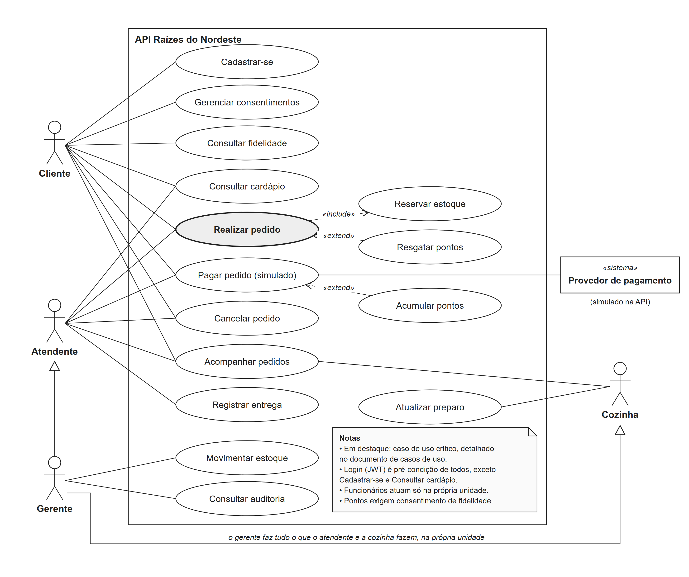

# Casos de uso

> Nota: elaborado com apoio de IA (Claude Code) e revisado pelo autor.

## Diagrama

Versão vetorial: [img/casos-de-uso.svg](img/casos-de-uso.svg).

## Atores

| Ator | Tipo | Descrição |
| --- | --- | --- |
| Cliente | Principal | Pessoa que compra pelo app, pela web ou para retirada. Não pertence a uma unidade. |
| Atendente | Principal | Funcionário que registra pedidos de balcão e totem e entrega os pedidos prontos, só na própria unidade. |
| Cozinha | Principal | Funcionário que conduz o preparo dos pedidos pagos da própria unidade. |
| Gerente | Principal | Faz tudo o que o atendente e a cozinha fazem na própria unidade, e também ajusta estoque e consulta a auditoria. No diagrama, isso aparece como herança (generalização) entre atores. |
| Provedor de pagamento | Secundário (sistema) | Serviço externo que aprova ou recusa o pagamento. Neste protótipo é simulado pela própria API. |

## Lista de casos de uso

O login (`POST /auth/login`) é pré-condição de todos os casos de uso, exceto UC01 e UC04. Por isso ele não aparece como caso de uso separado.

| ID | Caso de uso | Atores | Rota |
| --- | --- | --- | --- |
| UC01 | Cadastrar-se | Cliente | `POST /auth/cadastro` |
| UC02 | Gerenciar consentimentos | Cliente | `GET` e `POST /me/consentimentos` |
| UC03 | Consultar fidelidade | Cliente | `GET /me/fidelidade` |
| UC04 | Consultar cardápio | Cliente, Atendente | `GET /unidades`, `GET /unidades/{id}/cardapio` |
| **UC05** | **Realizar pedido (crítico)** | Cliente, Atendente | `POST /pedidos` |
| UC06 | Reservar estoque (incluído por UC05) | Sistema | Parte de `POST /pedidos` |
| UC07 | Resgatar pontos (estende UC05) | Cliente | Campo `pontosResgatados` em `POST /pedidos` |
| UC08 | Pagar pedido (simulado) | Cliente, Atendente, Provedor de pagamento | `POST /pedidos/{id}/pagamentos/mock` |
| UC09 | Acumular pontos (estende UC08) | Sistema | Parte do pagamento aprovado |
| UC10 | Cancelar pedido | Cliente, Atendente | `POST /pedidos/{id}/cancelamento` |
| UC11 | Acompanhar pedidos | Cliente, Atendente, Cozinha | `GET /pedidos`, `GET /pedidos/{id}` |
| UC12 | Atualizar preparo | Cozinha | `PATCH /pedidos/{id}/status` (`EM_PREPARO`, `PRONTO`) |
| UC13 | Registrar entrega | Atendente | `PATCH /pedidos/{id}/status` (`ENTREGUE`) |
| UC14 | Movimentar estoque | Gerente | `POST` e `GET /unidades/{id}/estoque/movimentacoes` |
| UC15 | Consultar auditoria | Gerente | `GET /auditoria` |

## Caso de uso crítico: UC05 Realizar pedido

É o caso de uso crítico porque inicia o fluxo principal do negócio (pedido, pagamento, preparo e entrega) e é o único que reserva estoque. Um erro nele afeta o caixa e o estoque de todas as unidades.

| Item | Descrição |
| --- | --- |
| **Objetivo** | Registrar um pedido em uma unidade e garantir os itens no estoque até o pagamento. |
| **Ator principal** | Cliente (canais `APP`, `WEB` e `PICKUP`). |
| **Outros atores** | Atendente ou gerente da unidade (canais `BALCAO`, `TOTEM` e `PICKUP`). |
| **Gatilho** | O ator envia `POST /pedidos` com a unidade, o canal e os itens. |
| **Relacionamentos** | Inclui UC06 Reservar estoque. É estendido por UC07 Resgatar pontos, quando o cliente informa `pontosResgatados`. |

### Pré-condições

1. O ator está autenticado (token JWT válido) e com o cadastro ativo.
2. O perfil do ator é Cliente, Atendente ou Gerente.
3. A unidade existe e está ativa. No caso de funcionário, é a própria unidade dele.
4. Os produtos pedidos têm oferta ativa na unidade.

### Fluxo principal

1. O cliente consulta o cardápio da unidade (UC04).
2. O cliente envia o pedido com a unidade (`unidadeId`), o canal (`canalPedido`, aqui `APP`) e os itens (`produtoId` e `quantidade`).
3. O sistema identifica o usuário pelo token e confere que o canal é permitido ao perfil dele.
4. O sistema confere que a unidade existe e está ativa.
5. O sistema cancela os pedidos vencidos da unidade e devolve as reservas deles, para trabalhar com o saldo real.
6. O sistema confere que não há produto repetido e que todos os produtos têm oferta ativa na unidade.
7. O sistema calcula o total com os preços cadastrados no servidor, ignorando qualquer valor enviado pelo cliente.
8. O sistema confere que há saldo livre suficiente para cada item.
9. O sistema grava o pedido com status `AGUARDANDO_PAGAMENTO` e prazo de 15 minutos, copia o nome e o preço de cada item e reserva o estoque (UC06): o saldo livre diminui e o saldo reservado aumenta.
10. O sistema registra `PEDIDO_CRIADO` na auditoria e confirma tudo em uma única transação.
11. O sistema responde `201` com o pedido, o total e o prazo (`expira_em`). O fluxo continua no pagamento (UC08).

### Fluxos alternativos

- **A1. Pedido de balcão.** No passo 2, um atendente ou gerente envia o pedido com canal `BALCAO`, `TOTEM` ou `PICKUP`, para a própria unidade. O pedido fica sem cliente identificado (`cliente_id` nulo), não pontua e não aceita resgate de pontos.
- **A2. Resgate de pontos (UC07).** No passo 2, o cliente informa `pontosResgatados`. Depois do passo 7, o sistema confere o consentimento de fidelidade, o saldo de pontos e os limites, e calcula o desconto (100 pontos valem R$ 5,00, até 50% do pedido). No passo 9, o total gravado já vem com o desconto e os pontos são debitados do saldo.

### Exceções

Em todas as exceções, nada é gravado: a transação é desfeita e o estoque não muda. A resposta segue o formato de erro padrão (`error`, `message`, `details`, `timestamp`, `path`).

| ID | Passo | Situação | Resposta |
| --- | --- | --- | --- |
| E1 | 3 | Sem token, token inválido ou usuário inativo | `401` (`NAO_AUTENTICADO`, `TOKEN_INVALIDO` ou `USUARIO_INATIVO`) |
| E2 | 2 | Corpo inválido: canal desconhecido, quantidade menor que 1, lista de itens vazia | `422` `DADOS_INVALIDOS`, com o campo em `details` |
| E3 | 3 | Canal não permitido ao perfil (por exemplo, cliente usando `BALCAO`) | `403` `CANAL_NAO_PERMITIDO` |
| E4 | 3 | Perfil Cozinha tentando criar pedido | `403` `PERFIL_SEM_PERMISSAO` |
| E5 | 3 | Funcionário criando pedido em outra unidade | `403` `UNIDADE_NAO_PERMITIDA` |
| E6 | 4 | Unidade inexistente ou inativa | `404` `UNIDADE_NAO_ENCONTRADA` |
| E7 | 6 | Mesmo produto repetido no pedido | `422` `ITENS_DUPLICADOS` |
| E8 | 6 | Produto inexistente, desativado ou sem oferta ativa na unidade | `404` `PRODUTO_INDISPONIVEL` |
| E9 | 8 | Saldo livre menor que a quantidade pedida | `409` `ESTOQUE_INSUFICIENTE` |
| E10 | A2 | Resgate sem consentimento de fidelidade ativo | `409` `FIDELIDADE_INATIVA` |
| E11 | A2 | Pontos acima do saldo | `409` `SALDO_PONTOS_INSUFICIENTE` |
| E12 | A2 | Pontos fora de múltiplos de 100, ou desconto acima de 50% do pedido | `422` `DADOS_INVALIDOS` ou `DESCONTO_ACIMA_DO_LIMITE` |
| E13 | A2 | Funcionário tentando resgatar pontos | `403` `PERFIL_SEM_PERMISSAO` |

### Pós-condições

**Em caso de sucesso:**

- O pedido existe com status `AGUARDANDO_PAGAMENTO` e `expira_em` igual à criação mais 15 minutos.
- Cada item guarda uma cópia do nome e do preço da oferta. Mudanças posteriores no catálogo não alteram o pedido.
- O estoque de cada item passou do saldo livre para o saldo reservado.
- Com resgate (A2), o pedido guarda `desconto_centavos` e `pontos_resgatados`, e o extrato de fidelidade tem um débito.
- A auditoria da unidade tem o evento `PEDIDO_CRIADO`.

**Em caso de falha:** nenhum dado é gravado e o estoque não muda.

### O que acontece depois

- **Pagamento aprovado (UC08):** o pedido vai para `CONFIRMADO`, a reserva é consumida e, com consentimento, o cliente ganha pontos (UC09).
- **Pagamento recusado, cancelamento (UC10) ou prazo vencido:** o pedido vai para `CANCELADO`, a reserva volta ao saldo livre e os pontos resgatados são devolvidos.
- **Falha do provedor:** a API responde `503`, nenhum pagamento é gravado e o pedido continua aguardando, dentro do prazo.
- **Depois do pagamento:** a cozinha prepara (UC12) e o atendente entrega (UC13).

### Regras de negócio aplicadas

- **Canais por perfil:** cliente usa `APP`, `WEB` e `PICKUP`; atendente e gerente usam `BALCAO`, `TOTEM` e `PICKUP`.
- **Escopo:** funcionário só opera na própria unidade, e IDs ou perfis enviados no corpo não concedem acesso.
- **Preço:** o preço vem sempre do servidor e o total é a soma de quantidade vezes preço, menos o desconto por pontos.
- **Reserva:** a reserva vale por 15 minutos e é liberada na próxima operação que consultar a unidade, sem processo agendado.
- **Estoque:** nenhum saldo fica negativo, o que o banco também garante com restrições `CHECK`.

### Evidências

- **pytest:** `test_order_items_return_catalog_product_id`, `test_client_cannot_create_balcao_order`, `test_invalid_channel_and_invalid_quantity`, `test_order_beyond_stock_is_rejected_without_reserving`, `test_inactive_product_is_unavailable`, `test_points_become_discount_and_paid_value_earns_points` e `test_redemption_limits`.
- **Postman:** P02, P04, P05, P06, F06 e F07.
- **Plano de testes:** cenários CT04, CT11, CT16, CT17, CT18 e CT28 em [PLANO_DE_TESTES.md](PLANO_DE_TESTES.md).
