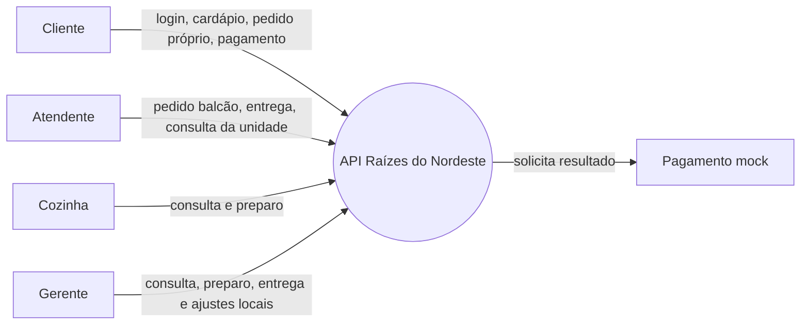
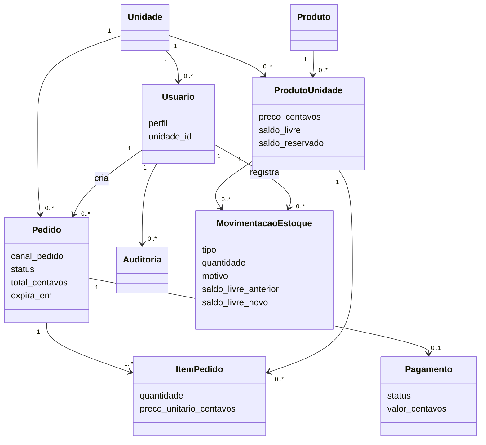
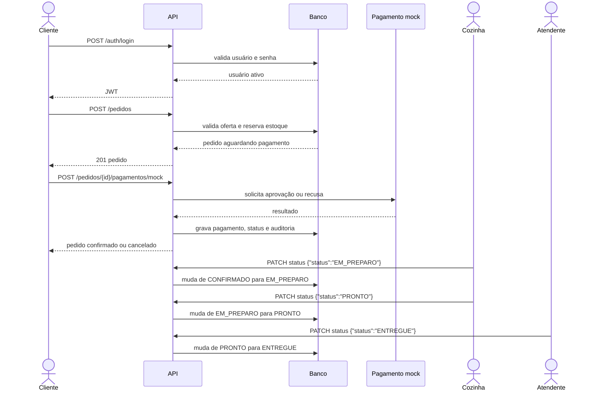

# Diagramas da solução

Os diagramas representam o MVP implementado. O DER completo está em [MODELO.md](MODELO.md).

## Casos de uso

Caso de uso principal: o usuário autenticado cria um pedido para uma unidade, o estoque é reservado, o pagamento mock retorna aprovação ou recusa e a API atualiza o pedido. A cozinha conduz o preparo e o atendente registra a entrega.

## Classes de domínio

## Sequência do fluxo crítico

