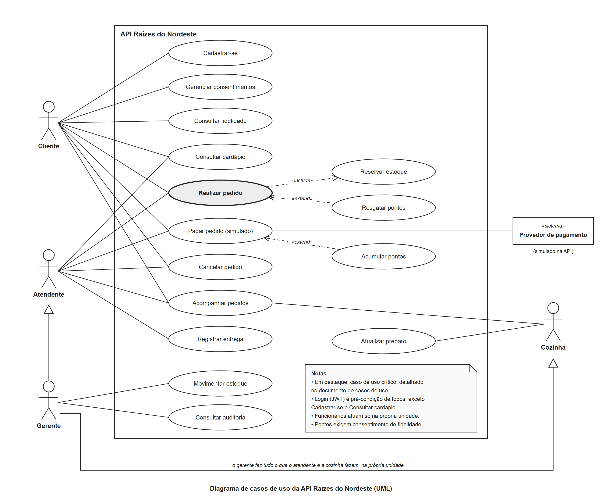
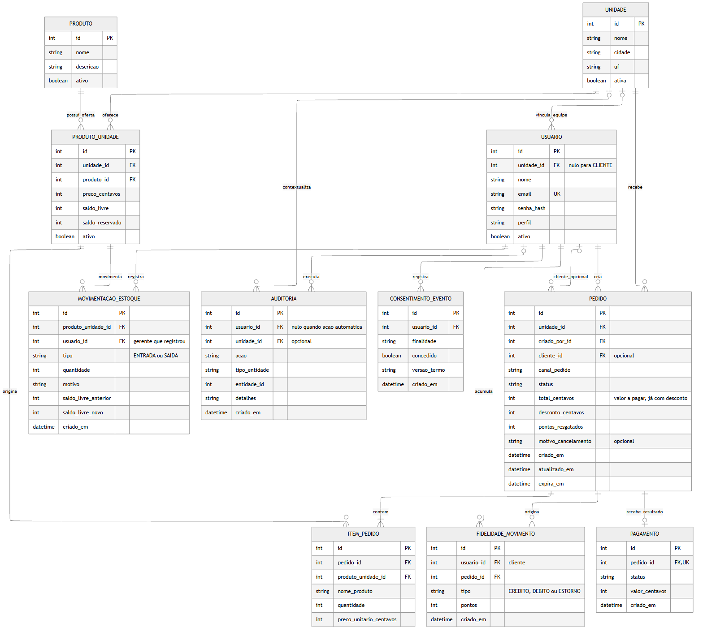
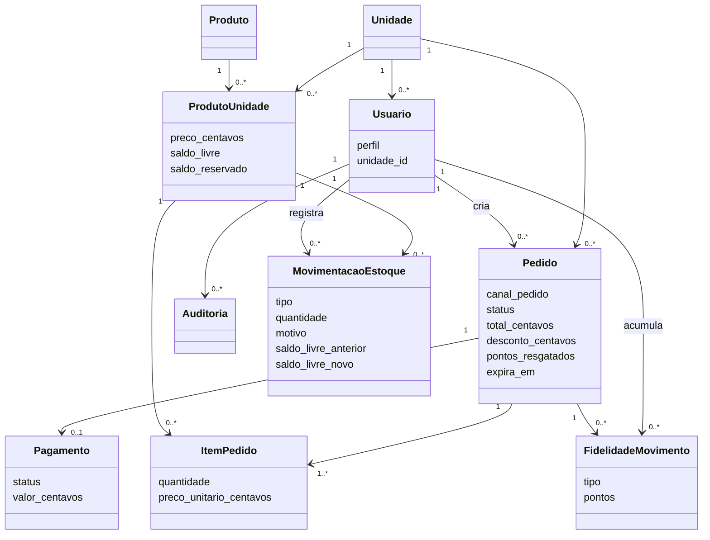
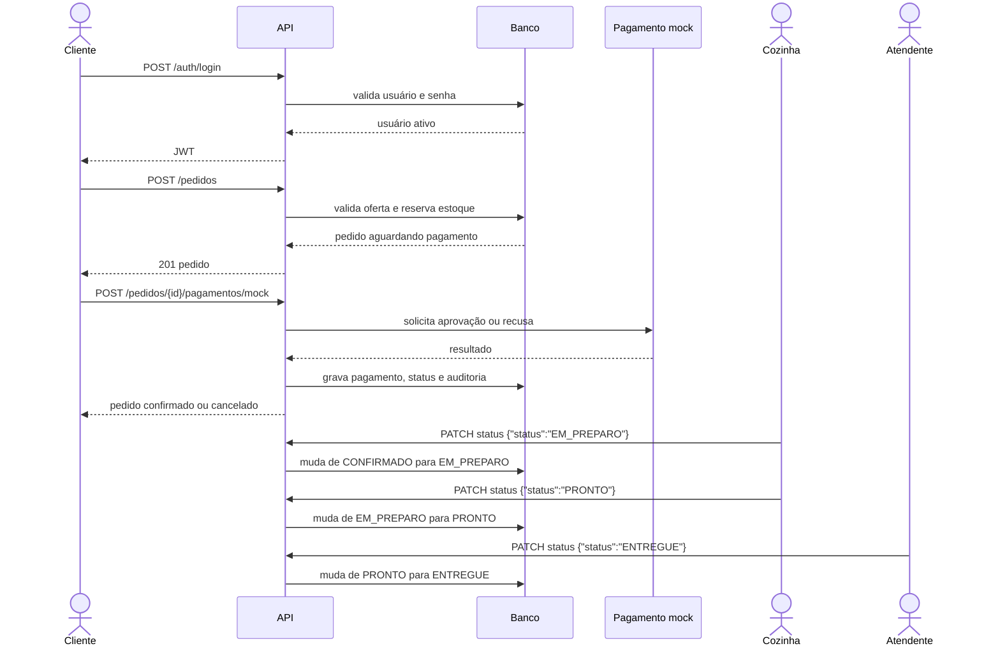

# Diagramas da solução

> Nota: trechos alterados com apoio de IA (Claude Code) e revisados pelo autor.

Os diagramas representam o MVP implementado. O DER, com restrições e regras de cada tabela, está detalhado em [MODELO.md](MODELO.md).

## Casos de uso

Atores, lista completa dos casos de uso e a descrição detalhada do caso crítico (Realizar pedido) estão em [CASOS_DE_USO.md](CASOS_DE_USO.md).

## DER

Versão vetorial em [img/der.svg](img/der.svg). A imagem é gerada a partir do DER em Mermaid do [MODELO.md](MODELO.md), com o código em [img/der.mmd](img/der.mmd).

## Classes de domínio

## Sequência do fluxo crítico

