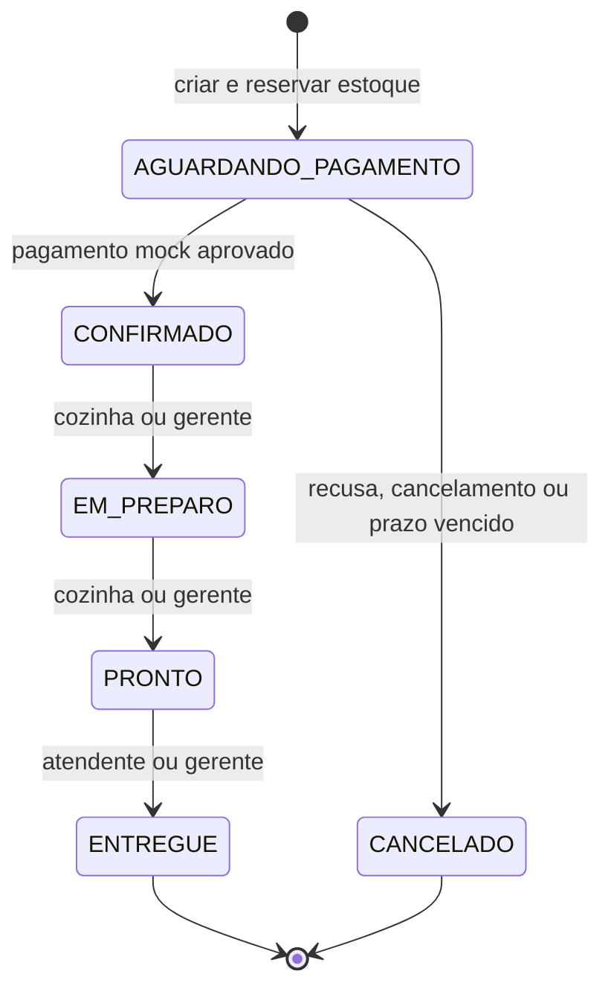
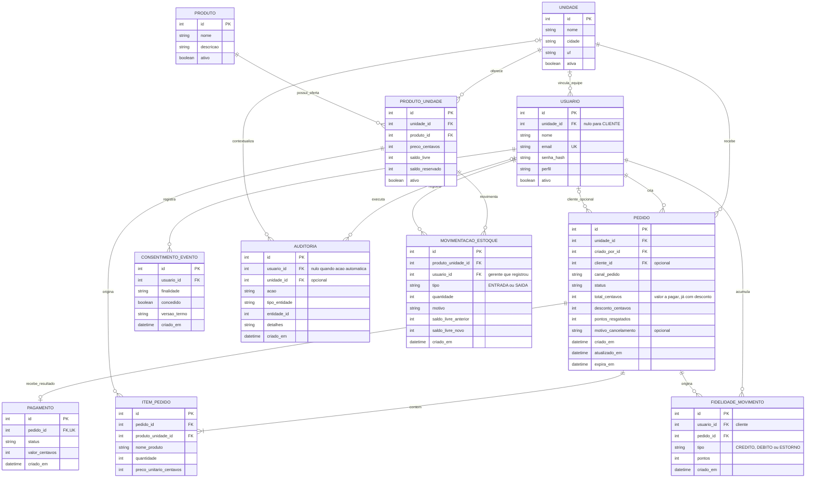

# Modelo inicial do Back-end

> Nota: trechos alterados com apoio de IA (Claude Code) e revisados pelo autor.

Decisões para implementar o fluxo pedido → pagamento mock → preparo → entrega. Este documento define permissões, estados e o DER proposto. Ainda não há banco nem API implementados.

## 1. Recorte do MVP

- Uma API FastAPI e um banco SQLite, com duas unidades e dados fictícios no seed.
- Quatro perfis fixos. Cada funcionário pertence a uma unidade; o cliente não pertence a uma unidade.
- Estoque contado em unidades inteiras de produto pronto. Ingredientes e receitas ficam como evolução.
- Preço, disponibilidade e estoque local ficam juntos em `produto_unidade`.
- Pagamento totalmente simulado, à vista e pelo valor integral. Um pedido tem no máximo um resultado de pagamento.
- Compra não exige adesão à fidelidade ou marketing. Com consentimento `FIDELIDADE` ativo, o cliente ganha 1 ponto por real pago e pode usar cada 100 pontos como R$ 5,00 de desconto, até 50% do pedido. Validade de pontos, níveis de cliente, campanhas e relatórios da matriz ficam descritos como evolução.

## 2. Perfis e permissões

| Ação | CLIENTE | ATENDENTE | COZINHA | GERENTE |
| --- | --- | --- | --- | --- |
| Consultar unidades e cardápio | Permitido, inclusive sem login | Permitido | Permitido | Permitido |
| Criar conta | Cadastro público, sem login; a conta nasce como CLIENTE | Não (equipe vem do seed) | Não | Não |
| Criar pedido | Para si, em unidade ativa | Na própria unidade | Não | Na própria unidade |
| Consultar/listar pedidos e filtrar canal/status | Somente próprios | Da própria unidade | Da própria unidade, apenas confirmados, em preparo, prontos ou entregues | Da própria unidade |
| Solicitar pagamento mock | Do próprio pedido | De pedido da própria unidade | Não | De pedido da própria unidade |
| Cancelar antes do pagamento | Próprio pedido | Pedido da própria unidade | Não | Pedido da própria unidade |
| Iniciar preparo e marcar pronto | Não | Não | Na própria unidade | Na própria unidade |
| Marcar entregue | Não | Na própria unidade | Não | Na própria unidade |
| Ajustar oferta, preço e estoque local | Não | Não | Não | Na própria unidade, com motivo registrado |
| Consultar auditoria | Não | Não | Não | Da própria unidade |
| Consultar/alterar consentimentos | Somente próprios | Não | Não | Não |
| Consultar saldo e extrato de pontos; resgatar pontos no pedido | Somente próprios, com consentimento `FIDELIDADE` ativo para resgatar | Não | Não | Não |

Regras de aplicação:

1. O servidor obtém usuário, perfil e unidade do usuário autenticado. IDs e perfis enviados no corpo não concedem acesso. Tokens precisam estar válidos e o usuário ativo.
2. O cliente cria pedidos com `cliente_id = criado_por_id = usuário autenticado`. Não escolhe outro cliente no request.
3. Atendente e gerente criam pedidos presenciais com `criado_por_id = usuário autenticado` e `cliente_id = NULL`. Não é necessário cadastrar o consumidor do balcão. Vinculação posterior e fidelidade nesses pedidos ficam fora do MVP.
4. Canais permitidos: cliente usa `APP`, `WEB` ou `PICKUP`; atendente/gerente usam `BALCAO`, `TOTEM` ou `PICKUP`. O totem é representado por chamadas autenticadas de um atendente no protótipo. O canal não altera permissões.
5. Gerente não possui acesso global. Cadastros de unidades, produtos e equipe entram pelo seed; administração da matriz e cadastro de equipe pela API ficam como evolução. O cadastro público (`POST /auth/cadastro`) cria apenas clientes: perfil e unidade nunca vêm do request, o aceite dos termos de uso é obrigatório e os consentimentos de fidelidade e marketing são opcionais e separados.
6. Respostas de cozinha trazem ID do pedido, canal, itens e status, sem nome, e-mail, senha ou token de clientes. Os demais perfis também recebem apenas os campos necessários.
7. Sem autenticação: `401`. Perfil sem permissão: `403`. Registro inexistente ou fora da unidade/propriedade permitida: `404`. Listagens já aplicam o filtro de acesso e possuem paginação.

## 3. Fluxo de status do pedido

| Origem | Destino | Quem provoca | Efeito no estoque |
| --- | --- | --- | --- |
| Sem pedido | AGUARDANDO_PAGAMENTO | Cliente, atendente ou gerente autorizado | Reserva os itens |
| AGUARDANDO_PAGAMENTO | CONFIRMADO | Serviço de pagamento mock, após aprovação | Consome a reserva |
| AGUARDANDO_PAGAMENTO | CANCELADO | Serviço mock após recusa; cliente/atendente/gerente autorizado; ou expiração | Devolve a reserva |
| CONFIRMADO | EM_PREPARO | Cozinha ou gerente da unidade | Nenhum |
| EM_PREPARO | PRONTO | Cozinha ou gerente da unidade | Nenhum |
| PRONTO | ENTREGUE | Atendente ou gerente da unidade | Nenhum |

- A rota de status só permite as transições manuais da tabela. O cliente não pode definir `CONFIRMADO` diretamente; isso depende do pagamento aprovado.
- Cancelamento voluntário só ocorre em `AGUARDANDO_PAGAMENTO`. Cancelamento de pedido pago e estorno ficam fora deste MVP; tentativa retorna `409`.
- `CANCELADO` e `ENTREGUE` são finais. Não se pulam etapas nem se reabre pedido. Repetir o status atual, após conferir a permissão, devolve o estado existente sem repetir efeitos ou auditoria de alteração.
- `motivo_cancelamento` recebe `SOLICITADO`, `PAGAMENTO_RECUSADO` ou `PRAZO_EXPIRADO`. É obrigatório quando o pedido é cancelado e nulo nos demais estados.
- Pagamento tem seus próprios resultados `APROVADO` e `RECUSADO`. Cancelamento manual/expiração pode ocorrer sem registro de pagamento.

### Reserva e prazo

Para o protótipo, fica adotado o prazo de **15 minutos** a partir da criação. Esse tempo é uma decisão do projeto, não uma exigência dos PDFs. O servidor grava `expira_em` em UTC; a reserva vence quando o relógio do servidor alcança esse instante, somente se o pedido ainda aguarda pagamento.

A liberação será feita por uma única função da camada de aplicação, antes de ler ou alterar pedidos, cardápio e estoque da unidade. Ela cancela os pedidos vencidos, devolve suas reservas e grava auditoria na mesma transação. Assim, não é necessário um processo agendado. Se a API estiver parada, a atualização física ocorrerá na próxima operação; um pagamento após o vencimento será recusado com `409`.

| Operação, para quantidade Q | saldo_livre | saldo_reservado |
| --- | --- | --- |
| Criar pedido | diminui Q | aumenta Q |
| Aprovar pagamento | não muda | diminui Q |
| Recusar/cancelar/expirar | aumenta Q | diminui Q |

O saldo físico antes do consumo é `saldo_livre + saldo_reservado`. Ajustes do gerente alteram apenas o saldo livre e nunca retiram itens reservados. Nenhum saldo pode ser negativo. Preço ou disponibilidade alterados depois da compra não modificam o pedido já reservado.

### Transações e repetição

Criação, pagamento, cancelamento e expiração serão operações de banco atômicas: pedido, itens, estoque, pagamento e auditoria envolvidos são confirmados juntos ou desfeitos juntos. A reserva exige saldo suficiente para todos os itens. A implementação deve impedir que duas operações consumam o mesmo saldo; erro de gravação nunca deve deixar uma atualização parcial.

O simulador recebe um cenário de teste de aprovação ou recusa e retorna um resultado local, sem chamada a provedor real. Há uma restrição `UNIQUE(pedido_id)` em `pagamento`. Repetir a mesma simulação retorna o pagamento já registrado; tentar trocar o resultado retorna `409`. A permissão é conferida mesmo na repetição. Não há segunda tentativa em pedido recusado; cria-se um novo pedido. Uma falha técnica simulada retorna `503`, mantém o pedido aguardando e não grava pagamento; a reserva continua sujeita ao prazo.

## 4. DER proposto

São onze tabelas: as nove da migração inicial, `movimentacao_estoque` (migração `0002`) e `fidelidade_movimento` (migração `0003`, que também acrescenta `desconto_centavos` e `pontos_resgatados` ao pedido). Os nomes abaixo são os nomes internos do banco; a API usa `canalPedido` para o campo interno `canal_pedido`. Campos terminados em `_centavos` são inteiros: por exemplo, R$ 12,50 é gravado como `1250`, evitando arredondamento de ponto flutuante.

Na relação da equipe, cada funcionário possui exatamente uma unidade; um cliente possui zero. Um pedido sempre tem um criador e pode não ter cliente identificado. A relação `contem` representa a regra de pelo menos um item, validada pela aplicação na transação de criação.

### Restrições de banco e regras da aplicação

| Local | Regra |
| --- | --- |
| Todas as tabelas | PK inteira; FK obrigatória salvo os campos declarados opcionais; datas UTC; impedir exclusão de registros referenciados. Desativar cadastros em vez de apagar histórico. |
| usuario | E-mail normalizado em minúsculas, sem espaços nas extremidades e único; perfil entre os quatro definidos; unidade nula para CLIENTE e obrigatória para funcionários. Não permitir mudança de unidade de funcionário com histórico no MVP. |
| produto_unidade | `UNIQUE(unidade_id, produto_id)`; preço maior que zero; saldos inteiros não negativos. |
| pedido | Canal e status limitados aos valores definidos; total positivo; expiração posterior à criação; motivo compatível com cancelamento. Unidade/criador/cliente/canal não mudam após criar. |
| item_pedido | `UNIQUE(pedido_id, produto_unidade_id)`; quantidade inteira positiva; preço positivo. A aplicação rejeita itens repetidos no request com `422` e exige que todas as ofertas pertençam à unidade do pedido. |
| Valores | O servidor busca o preço da oferta e grava uma cópia no item. Total é a soma de quantidade × preço dos itens; o nome também fica preservado. Valores de preço/total enviados pelo cliente não são usados como autoridade. Não há taxa. O único desconto é o resgate de pontos: `total_centavos` = soma dos itens − `desconto_centavos`, e o pagamento usa esse total. |
| pagamento | Pedido único; valor igual ao total do pedido; resultado entre APROVADO/RECUSADO. Resultado e valor são imutáveis. A aplicação mantém correspondência entre resultado e estado do pedido. |
| consentimento_evento | Finalidade FIDELIDADE ou MARKETING; versão do termo e data obrigatórias. Sem evento, não há consentimento. A opção atual é o evento mais recente por finalidade, ordenado por data e ID. Concessão e revogação acrescentam eventos; não sobrescrevem o histórico. |
| fidelidade_movimento | Tipo `CREDITO`, `DEBITO` ou `ESTORNO`; pontos inteiros positivos; sempre ligado a um pedido. Saldo = créditos + estornos − débitos, nunca negativo (o resgate confere o saldo). Crédito só com consentimento ativo no pagamento; estorno só para pedido com pontos resgatados que foi cancelado. Registros não são editados nem apagados. |
| movimentacao_estoque | Tipo `ENTRADA` ou `SAIDA`; quantidade inteira positiva; motivo obrigatório (3 a 200 caracteres); saldos anterior e novo não negativos. Altera só o saldo livre da oferta: a saída nunca passa do saldo livre e nunca retira itens reservados. Registros não são editados nem apagados. |
| auditoria | Registrar criação, pagamento, mudanças de status, cancelamento, expiração, ajuste de estoque/preço e alterações/consultas de consentimento. Incluir valores anteriores/novos necessários, sem senha, token, e-mail ou conteúdo completo de requests. |

`tipo_entidade` e `entidade_id` identificam o objeto na auditoria, mas não formam uma FK polimórfica: a aplicação valida o alvo ao gravar. Auditoria não tem edição/exclusão por API. Eventos de expiração usam usuário nulo e a unidade do pedido; eventos de consentimento usam a pessoa autenticada e unidade nula. Gerentes não consultam eventos pessoais sem unidade. Cadastro/equipe e permissão são conferidos novamente nas operações; possuir um ID válido não basta.

## 5. Casos que a implementação deverá comprovar

1. Cliente não consulta nem paga pedido de outra pessoa; funcionário não opera outra unidade, inclusive com IDs enviados manualmente.
2. Cozinha não paga/cancela pedido; atendente não altera preço nem marca preparo/pronto; gerente atua apenas na própria unidade.
3. Pedido sem canal ou com canal inválido retorna `422`; canal válido não permitido ao perfil retorna `403`.
4. Oferta de outra unidade, quantidade inválida, produto inexistente e falta de estoque são rejeitados sem gravação parcial.
5. Duas criações disputando a última unidade não geram saldo negativo nem dois pedidos aceitos para o mesmo item disponível.
6. Aprovação, recusa, cancelamento e expiração movimentam a reserva uma única vez, inclusive com repetição e disputa simultânea.
7. Pedido vencido não pode ser pago. A próxima consulta/operação libera a reserva e registra motivo e auditoria.
8. Não se pula de confirmado para entregue, nem se altera pedido finalizado; pedidos pagos não são cancelados neste recorte.
9. Alterar preço/nome do catálogo não muda os valores e a identificação do item já comprado.
10. Cliente compra sem consentimento; aceitar/revogar uma finalidade não altera a outra e mantém histórico.

Esses casos serão incorporados à coleção e aos testes da API. Aqui estão definidos, ainda não executados. A próxima etapa é criar os modelos, a primeira migração e o seed conforme este documento.
