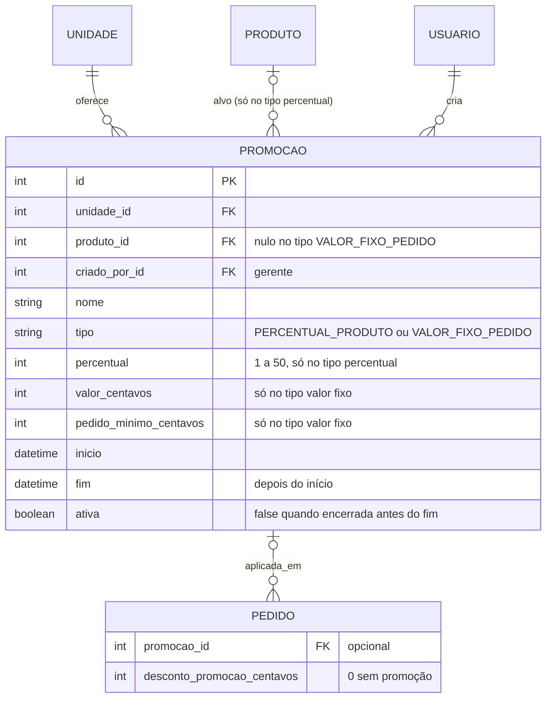

# Regras de promoção

> Nota: elaborado com apoio de IA (Claude Code) e revisado pelo autor.

> **Situação:** proposta documentada, **não implementada**. O roteiro aceita que as regras de promoção sejam apenas documentadas. Este texto descreve como elas funcionariam na API atual, para que a implementação futura não precise redefinir nada.

## Objetivo

Permitir que cada unidade crie descontos temporários para atrair clientes (por exemplo, uma "Semana do São João"), sem mexer no preço de tabela e sem afetar pedidos já feitos.

## Regras

1. **Quem cria e onde vale.** O gerente cria a promoção apenas para a própria unidade, com data e hora de início e de fim (gravadas em UTC, como as demais datas). Fora desse período, ou em outra unidade, a promoção não existe. Ela vale para todos os canais de venda da unidade.
2. **Dois tipos.**
   - **Percentual em um produto** (`PERCENTUAL_PRODUTO`): de 1% a 50% sobre o valor desse produto no pedido (preço × quantidade), arredondado para baixo no centavo.
   - **Valor fixo em pedido** (`VALOR_FIXO_PEDIDO`): desconto em reais para pedidos a partir de um valor mínimo. O desconto não pode passar de 50% desse mínimo.
3. **Aplicação automática.** O cliente não digita código. Ao criar o pedido, o servidor procura as promoções vigentes da unidade e aplica a que se encaixa.
4. **Uma promoção por pedido.** Se mais de uma valer ao mesmo tempo, o servidor aplica a que der o **maior desconto** ao cliente. Promoções não se somam entre si. Em caso de empate, vale a que termina primeiro.
5. **Ordem do cálculo com fidelidade.** Primeiro soma-se o valor dos itens, depois aplica-se a promoção e só então os pontos de fidelidade. A promoção pode somar com os pontos, mas o **desconto total (promoção + pontos) não passa de 50%** do valor dos itens, a mesma trava que já existe para os pontos. Se o resgate de pontos estourar esse teto, o pedido é recusado com `422` (`DESCONTO_ACIMA_DO_LIMITE`), como hoje.
6. **Preço congelado no pedido.** O pedido guarda qual promoção foi aplicada e quanto ela descontou. Encerrar ou alterar a promoção depois não muda pedidos já criados, do mesmo jeito que hoje uma mudança de preço não altera o item já comprado.
7. **Pontos de fidelidade sobre o valor pago.** O cliente continua ganhando 1 ponto por real **efetivamente pago**, ou seja, depois da promoção e dos pontos usados.
8. **Cancelamento.** Se o pedido for cancelado, recusado ou vencer, nada da promoção precisa ser devolvido: ela não tem saldo, só deixa de valer para aquele pedido. Os pontos resgatados voltam, como já acontece.
9. **Encerramento antecipado.** O gerente pode encerrar uma promoção antes do fim. Ela não é apagada, porque pedidos antigos apontam para ela.
10. **Auditoria.** Criação e encerramento entram na auditoria da unidade (`PROMOCAO_CRIADA`, `PROMOCAO_ENCERRADA`), com tipo, valores e período.

## Exemplos

Preços do seed na unidade Recife Centro: tapioca R$ 18,90 e suco de cajá R$ 8,90.

| Cenário | Pedido | Promoção aplicada | Pontos | Paga |
| --- | --- | --- | --- | --- |
| A. 10% na tapioca | 2 tapiocas = R$ 37,80 | 10% de R$ 37,80 = R$ 3,78 | não usa | **R$ 34,02** (ganha 34 pontos) |
| B. R$ 5,00 em pedidos a partir de R$ 50,00 | 3 tapiocas = R$ 56,70 | R$ 5,00 | não usa | **R$ 51,70** |
| C. Promoção + pontos dentro do teto | 2 tapiocas + 1 suco = R$ 46,70 | 10% nas tapiocas = R$ 3,78 | 300 pontos = R$ 15,00 | Desconto total R$ 18,78 (teto: R$ 23,35) → **R$ 27,92** |
| D. Promoção + pontos acima do teto | o mesmo pedido de R$ 46,70 | R$ 3,78 | 400 pontos = R$ 20,00 | Desconto total R$ 23,78 > R$ 23,35 → **recusado com `422`** |
| E. Duas promoções valendo juntas | 3 tapiocas = R$ 56,70 | 10% na tapioca = R$ 5,67 contra R$ 5,00 fixo → aplica os **10%** | não usa | **R$ 51,03** |

## Modelo de dados proposto

Uma tabela nova, `promocao`, e dois campos novos em `pedido`, criados por uma migração `0004`:

Restrições propostas: `percentual` entre 1 e 50; `valor_centavos` positivo e no máximo metade de `pedido_minimo_centavos`; `fim` maior que `inicio`; e um dos dois tipos preenchido, nunca os dois. O total do pedido passaria a ser: soma dos itens − `desconto_promocao_centavos` − `desconto_centavos` (pontos).

## Endpoints propostos

| Método e rota | Quem usa | O que faz |
| --- | --- | --- |
| `POST /unidades/{unidade_id}/promocoes` | Gerente da unidade | Cria a promoção. `422` para percentual fora de 1–50, fim antes do início ou tipo incompleto; `403` para outro perfil ou unidade. |
| `GET /unidades/{unidade_id}/promocoes` | Público | Lista as promoções vigentes da unidade, para o app mostrar. |
| `POST /unidades/{unidade_id}/promocoes/{promocao_id}/encerramento` | Gerente da unidade | Encerra antes do fim, sem apagar. |

O cardápio (`GET /unidades/{id}/cardapio`) passaria a mostrar também o preço promocional de cada produto, e a resposta do pedido traria `promocao_id` e `desconto_promocao_centavos`.

## Testes que comprovariam as regras

- Os cenários A a E acima, com os valores exatos.
- Promoção fora do período ou de outra unidade não é aplicada.
- Cliente e atendente não criam promoção (`403`); gerente de outra unidade também não.
- Encerrar a promoção não altera o total de um pedido já criado.
- Pontos ganhos são calculados sobre o valor pago depois dos descontos.

## Fora do escopo

Cupons com código, promoções da matriz para todas as unidades, combos ("leve 3, pague 2"), horário promocional dentro do dia e limite de uso por cliente ficam como evolução futura.
